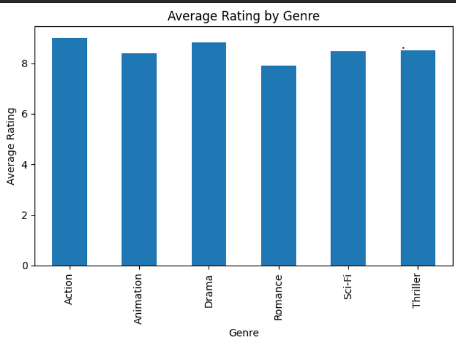
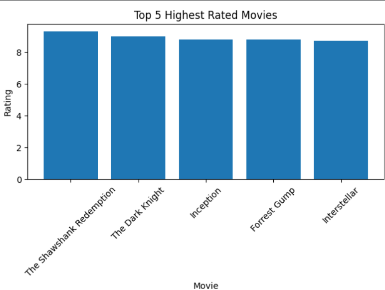

# Movie Ratings Analysis 📊

## Project Overview
This project explores movie ratings using Python and data analysis techniques. It examines movie genres, ratings, and audience votes to identify rating patterns and top-rated movies.

## Objectives
- Analyse movie rating distributions.
- Calculate average ratings.
- Identify the highest-rated movies.
- Compare average ratings across genres.
- Visualise insights using charts.

## Tools & Technologies
- Python
- Pandas
- Matplotlib
- Google Colab
- GitHub

## Dataset
A sample dataset containing 10 movies with the following attributes:
- Movie Title
- Genre
- Release Year
- Rating
- Votes

## Key Analysis
- Overall average movie rating.
- Highest-rated movie identification.
- Top 5 highest-rated movies.
- Genre-wise average rating comparison.

## Visualisation Results

### 1. Average Rating by Genre

### 2. Top 5 Highest Rated Movies

## Key Insights

- Identified differences in average ratings across movie genres.
- Highlighted the top 5 highest-rated movies in the dataset.
- Used Python visualizations to communicate rating patterns.
- Applied Pandas for data analysis and Matplotlib for visualization.

## Limitations

- The current dataset contains only 10 movies.
- The findings are based on a small sample and may not represent overall movie-rating trends.
- A larger dataset would help produce more reliable insights.

## Future Improvements

- Expand the dataset with more movies.
- Explore rating distributions and genre comparisons.
- Build an interactive Power BI dashboard.

## Project Files
- `movie_ratings_analysis.py` – Python source code.
- `movie_ratings_analysis.ipynb` – Google Colab notebook.
- `movie_ratings.csv` – Dataset.

## Visualisation Results

### 1. Average Rating by Genre

### 2. Top 5 Highest Rated Movies

## Conclusion

This project demonstrates the use of Python for exploratory data analysis and visualization of movie ratings. Through Pandas and Matplotlib, the analysis identifies highly rated movies and compares average ratings across genres.

The project strengthened practical skills in data cleaning, data analysis, and visual storytelling.

